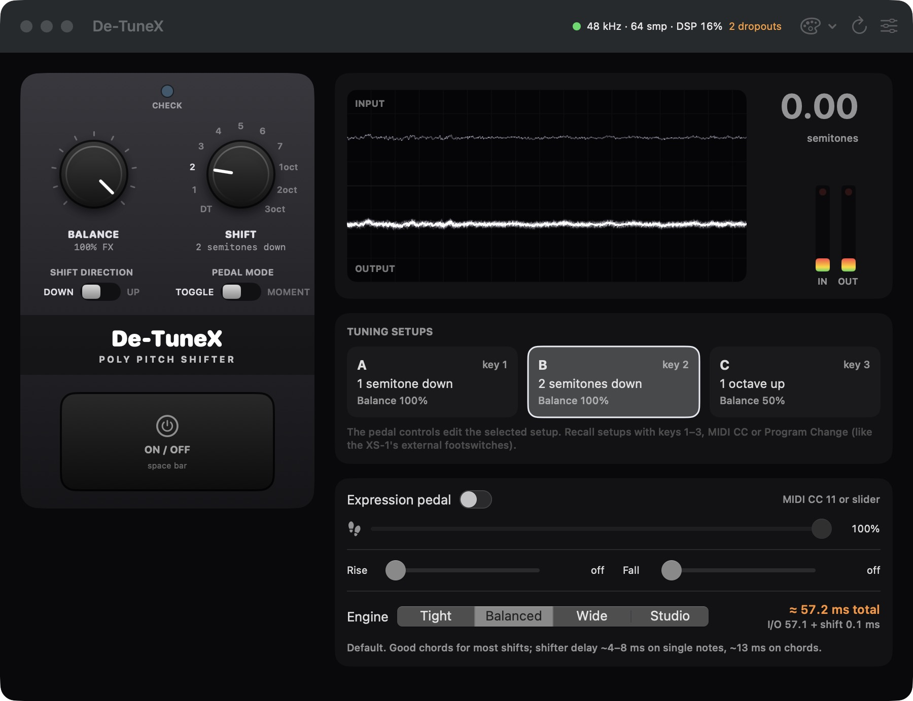

# De-TuneX — Poly Pitch Shifter for macOS

A native macOS app that does what the BOSS XS-1 Poly Shifter does: you plug a guitar into an audio interface and hear it polyphonically re-pitched in real time. It's built for playing live, so latency was the main design constraint.



<sub>Shown with the Mac's built-in microphone and speakers, which is why the I/O latency reads about 57 ms. With an audio interface it's a few ms (see [Getting the lowest latency](#getting-the-lowest-latency)).</sub>

* **SwiftUI** front panel styled like a compact pedal, **Metal** oscilloscope (input vs. shifted output)
* **C++ realtime DSP** (no Swift, locks or allocation on the audio thread)
* **CoreAudio HAL (AUHAL) duplex I/O** with device, channel, sample-rate and **buffer-size** selection
* **CoreMIDI** expression pedal / footswitch control, keyboard control
* Six colour themes and its own app icon

## What's new in 1.3

* **Stereo input.** In Audio Setup, choose an input pair such as **1 + 2 (stereo)**, for example for a stereo amp modeller like the Fractal AM4 on Apollo line inputs 1/2. Both sides are shifted with one shared splice timeline, worked out from the mid signal (L+R), so the stereo image stays put instead of wandering or phasing. With a mono output, the two sides are summed.
* **Fast attack** (on by default; the switch is next to the engine selector). When you pick or strum a new note, the shifter jumps straight to the newest audio, with a 2 ms crossfade, instead of waiting for a perfectly aligned splice. A new strum while the previous chord still rings now comes through in about **2 ms instead of 13–18 ms**. Chord quality stays within about 1 dB.
* **Diagnostic recording** (Audio Setup › Diagnostics) saves exactly what De-TuneX received and sent out, plus your settings. See [Diagnostics](#diagnostics).
* **Only one copy can run.** A second copy, for example the arm64 and x86_64 builds side by side, would play its own (often bypassed, dry) output on top. A newly started copy now brings the running one to the front and quits.

## What's new in 1.1

* **Much cleaner chords** on every engine. Each splice is now aligned over a 4× longer stretch of the waveform, so it matches all the strings of a chord instead of just the loudest one, with no added delay. On realistic strummed chords, artifacts drop from −22.7 to −26.4 dB (Balanced) and from −26.3 to −30.2 dB (Wide). See [Engines](#engines).
* **New Studio engine:** a long-window version of the main engine replaces the phase vocoder. Chord artifacts drop from −14.9 to −34.1 dB, and the delay falls from 43 to 36 ms.
* **Lower CPU use:** 0.5–1.9 % of one core.
* **Honest latency figures:** on chords the shifter needs ~13 ms (Balanced) or ~19 ms (Wide). The app and this README now say so.

## Download

Get the latest build from **[Releases](https://github.com/lydianb79/DeTuneX/releases/latest)**:

| File | Mac |
|---|---|
| `DeTuneX-arm64.zip` | Apple Silicon (M-series): "De-TuneX (Apple Silicon)" |
| `DeTuneX-x86_64.zip` | Intel: "De-TuneX (Intel)". Also runs on Apple Silicon through Rosetta 2, with more CPU load |

Requires **macOS 13 Ventura** or later.

**First launch.** The builds are ad-hoc signed and not notarized, so Gatekeeper blocks them at first:
1. Unzip, then move the app to **Applications**.
2. Right-click the app, choose **Open**, then **Open** again in the dialog. On macOS 15 and later, you may need **System Settings › Privacy & Security › Open Anyway** instead.
3. Allow **microphone** access. This is how macOS labels every audio input, including your interface's instrument input. Then open **Audio Setup** from the toolbar.

If you prefer the Terminal: `xattr -dr com.apple.quarantine /Applications/DeTuneX-arm64.app`

## Build from source

Requirements: macOS 13 or later, Xcode 15 or later (or the Command Line Tools with Swift 5.9 or later).

```bash
git clone https://github.com/lydianb79/DeTuneX.git
cd DeTuneX
bash scripts/build_app.sh     # → build/DeTuneX.app (native architecture, release, ad-hoc signed)
open build/DeTuneX.app
```

Architecture options:

```bash
bash scripts/build_app.sh --both        # two labelled apps + zips:
                                        #   build/DeTuneX-arm64.app   "De-TuneX (Apple Silicon)"
                                        #   build/DeTuneX-x86_64.app  "De-TuneX (Intel)"
bash scripts/build_app.sh --arm64       # Apple Silicon only
bash scripts/build_app.sh --x86_64      # Intel only (also runs on Apple Silicon via Rosetta 2)
bash scripts/build_app.sh --universal   # one app containing both architectures
```

On Apple Silicon, an x86_64 build runs under Rosetta 2, which macOS offers to install the first time you open it. Rosetta adds CPU overhead, so for the lowest latency on Apple Silicon use the native or universal build.

To work in Xcode, open `Package.swift` and run the `DeTuneX` scheme. When you run it unbundled from Xcode or with `swift run`, macOS asks for microphone permission on behalf of Xcode or Terminal instead of the app. Use the `.app` bundle for normal playing.

Each rebuild gets a new ad-hoc signature, so macOS may ask for permission again or remember an old "Don't Allow". To reset it, run `tccutil reset Microphone com.detunex.app`.

### Publishing a release

Build both architectures, then upload them with the GitHub CLI. This needs a login that has write access to the repository; `gh auth login --web` provides one.

```bash
bash scripts/build_app.sh --both
gh release create vX.Y.Z build/DeTuneX-arm64.zip build/DeTuneX-x86_64.zip \
  --target main --title "De-TuneX X.Y.Z" --notes-file <release-notes.md>
```

## Getting the lowest latency

Everything below is in **Audio Setup**, which also shows a full latency breakdown.

1. **Use one audio interface for both input and output.** If you pick two different devices, the app creates a hidden aggregate device. That works, but it adds safety buffers.
2. **Don't use the Mac's built-in microphone, built-in speakers or Bluetooth.** The built-in mic alone reports around 30 ms of input latency, and Bluetooth adds 100 ms or more. The app warns you if you select a Bluetooth device.
3. Pick the **highest sample rate** your interface handles comfortably (96 kHz roughly halves converter latency), then the **smallest buffer that doesn't crackle**: 64 samples to start, 32 or 16 if your CPU and driver allow it. The toolbar shows the DSP load and a dropout counter.
4. Set **Output timing** (IO cycle usage) to **50 %**. By default macOS calls the app at the start of each IO cycle; De-TuneX needs only a few percent of the cycle, so letting macOS call it later removes most of one buffer of output latency at no CPU cost. Go back toward 100 % if you hear crackles.
5. Leave **Fast attack** on. It makes new notes and strums sound about 2 ms after you pick them, even on chords.
6. Pick the engine by what you play: **Tight** for single notes and detune, **Balanced** for general use, **Wide** for chords with the cleanest live sound. **Studio** gives the best chords but ~36 ms of delay, so it's for practising and recording.
7. Turn off your interface's own direct monitoring of the guitar input. On a Universal Audio Apollo, mute that channel in UA Console; on a Volt, switch monitoring off. Otherwise you hear the dry and shifted signals together.
8. If the interface has its own driver or control panel, set its safety buffer to the lowest setting.

The **total latency** readout adds the converter and driver latency reported by the driver, the input buffer, the trimmed output buffer, and the pitch shifter's own delay. With a good USB or Thunderbolt interface at 48 kHz and 64 samples, expect about 3–6 ms of I/O, plus the shifter's delay: a few ms on single notes, 13–19 ms on chords with Balanced or Wide.

## Themes & icon

Pick a theme from the **palette** button in the toolbar or from **Pedal › Theme**. There are six: **Stealth** (graphite, the default), Ocean, Neon, Crimson, Emerald and Vintage (a light, cream-coloured enclosure). Each one restyles the pedal enclosure, the window, the panels and the Metal scope's grid, glow and trace colours. Your choice is remembered.

The app icon is `Support/AppIcon.icns`, generated by `scripts/make_icon.py` (Python + Pillow). Edit the script and run it again to change the icon.

## Controls (XS-1 mapping)

| XS-1 | De-TuneX |
|---|---|
| BALANCE knob | **BALANCE**: direct ↔ effect (constant-power). Effect-only for retuning, blend for octaves and 12-string sounds |
| SHIFT knob (±7 semitones, ±1–3 octaves, detune) | **SHIFT**: DT, 1–7, 1oct, 2oct, 3oct. In DT, a slider sets 1–20 cents |
| SHIFT DIRECTION switch | **DOWN / UP** |
| PEDAL MODE switch | **TOGGLE** (latching) / **MOMENT** (on while held) |
| Pedal switch | Big **footswitch** (click / hold) or the **space bar**. MIDI CC 80 by default |
| CTL/EXP: external footswitches → tuning setups | **Setups A/B/C**: keys **1–3**, MIDI CC 81–83 or Program Change 0–2. The front panel edits the selected setup |
| CTL/EXP: expression pedal → linear pitch | **Expression pedal** toggle: heel = no shift, toe = full shift. MIDI CC 11 by default, or the on-screen slider |
| Rise/fall time (XS-100 feature) | **Rise / Fall**: pitch glide when engaging or releasing (0–2 s) |
| CHECK indicator | LED follows effect engagement |

Bypass is fully transparent: when the effect is off, the output is bit-identical to the input with unity gain. Switching uses a 6 ms crossfade, so there are no clicks.

## Engines

All four engines use the same correlation-aligned granular shifter with different settings. Chords need a longer splice search than single notes, so the shifter's own delay is higher on chords than on single notes.

| Engine | Grain | Shifter delay, single notes* | Shifter delay, chords* | Chord artifacts** | Use for |
|---|---|---|---|---|---|
| **Tight** | 512 | ≈ 0.2–5 ms | ≈ 10 ms | −18 dB | single notes, detune |
| **Balanced** (default) | 1024 | ≈ 0.3–8 ms | ≈ 13 ms | −26 dB | general guitar use |
| **Wide** | 2048 | ≈ 0.4–14 ms | ≈ 19 ms | −30 dB | live chords, bass, drop tunings |
| **Studio** | 8192 | ≈ 1–45 ms | ≈ 36 ms | −34 dB | best chord quality for practice and recording |

\* At 48 kHz, measured by the test suite; the figure depends on the interval and on the notes played. With **Fast attack** on, the *attack* of a new note or strum comes through in about 2 ms on every engine (for downward and small upward shifts); the figures above are the delay of the sustained sound. The app shows the live value under **Engine** and in **Audio Setup**.
\** Energy that is not on a correctly shifted partial (warble sidebands, smearing, ghost tones), averaged over seven strummed chords and nine intervals. Lower is better; a perfect shifter scores about −42 dB.

**How it works.** The shifter reads overlapping Hann-windowed grains from a delay line at the shifted rate. The usual problem with this design is warble, chorusing and flanging where grains overlap. This one avoids most of it by choosing every grain's start point with a normalized cross-correlation search, so each splice lines up with the waveform it fades into:

* The comparison window is long (512–1024 samples), so a splice has to match all the strings of a chord at once, not just the loudest one.
* The search looks backwards in time, so the comparison itself adds no latency. The search range (up to ±900 samples) has to cover about one period of the lowest note, which is what sets the delay on chords.
* Among well-aligned candidates it takes the shortest delay, interpolated to a fraction of a sample, so detune stays in tune to within 0.2 cents.
* For large up-shifts the grains get shorter, so the delay doesn't keep growing.

Versions before 1.1 had a phase-vocoder Studio engine. It measured far worse on real chords (−15 dB) at a higher delay (43 ms), so it was replaced.

## Diagnostics

If something sounds wrong, open **Audio Setup › Diagnostics** and click **Record 10-second diagnostic** while you play with the effect on. It saves exactly what De-TuneX received (`input.wav`) and sent out (`output.wav`), plus your settings (`settings.txt`), in **Music › De-TuneX Diagnostics**. The files show whether a problem is inside the app or in the routing after it.

## Verification

`bash scripts/run_tests.sh` builds and runs `Tests/dsp_offline_test.cpp`. It runs on macOS or Linux and checks:

* pitch accuracy from −36 to +24 semitones on every engine (≤ 1 cent typical, apart from extreme up-shifts in Tight)
* polyphony: steady E major and low-string E5 chords (share of output energy on the target partials), plus **strummed chords** from a realistic string model with slightly out-of-tune strings, scored as artifact energy in dB with a pass limit per engine (Tight −16, Balanced −24, Wide −28, Studio −32 dB)
* level stability (< 0.05 dB ripple, unity gain)
* linked stereo: identical L/R gives exactly the mono result, zero crosstalk between sides, and correct pitch per side on every engine
* latency, rise/fall glides, expression scaling, bit-exact bypass, and CPU load (≈ 2 % of one core per engine)

Known limitation, reported by the test as INFO: **Tight** is weak on low-string chords, because its grains are shorter than the chord's period. Use **Balanced**, **Wide** or **Studio** for chords.

## Project layout

```
Package.swift
Sources/DSPCore/        C++17 DSP, C API (DSPCore.h): GrainShifter, Processor
Sources/AudioHost/      CoreAudio AUHAL duplex host + private aggregate device
Sources/DeTuneX/        SwiftUI app, Metal scope, CoreMIDI, device enumeration, settings
Tests/                  offline DSP test suite
Support/                Info.plist, entitlements, AppIcon.icns
scripts/build_app.sh    builds and ad-hoc signs the app (--both / --arm64 / --x86_64 / --universal)
scripts/run_tests.sh    runs the DSP test suite
scripts/make_icon.py    regenerates the app icon
```

Settings (devices, input/output channels including stereo, buffer, output timing, setups, MIDI map, theme) persist in `UserDefaults`.

*BOSS and XS-1 are trademarks of Roland Corporation. De-TuneX is an independent project, not affiliated with or endorsed by Roland, and it uses its own algorithms.*
